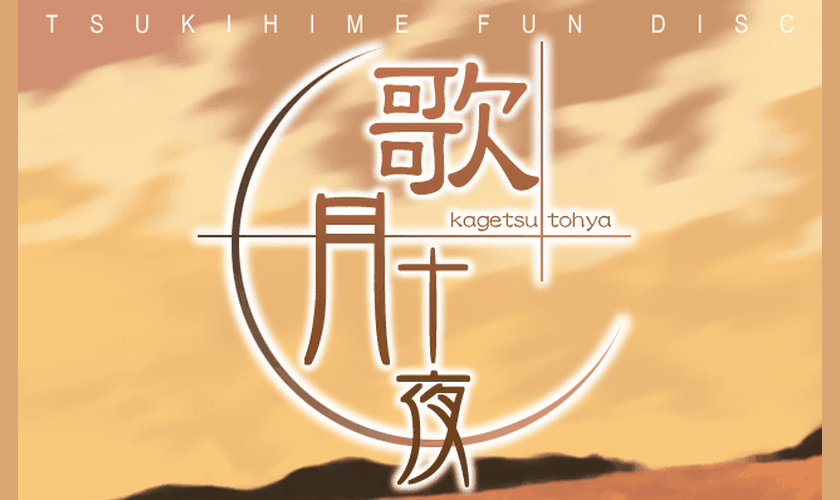

# Kagetsu Tohya Vita

This native Vita port runs compatible English Kagetsu Tohya NScripter data directly with ONScripter-JH. The initial test used English 0.5.3 with the 2022 revision, two NSA archives, a TrueType font, and OGG CD tracks. No conversion, VNDS player, Windows executable, or emulator is required.



## Download

Download [KagetsuTohyaVita-Release.vpk](https://github.com/OZZ0AB/kagetsu-tohya-vita/releases/latest/download/KagetsuTohyaVita-Release.vpk) from the [latest release](https://github.com/OZZ0AB/kagetsu-tohya-vita/releases/latest). Corresponding source and checksums accompany the VPK. Supply the game data from your own compatible English PC copy.

## Install

1. Install `KagetsuTohyaVita-Release.vpk` with VitaShell. Install over the existing test bubble when updating.
2. Create `ux0:data/kagetsu_tohya/game/`.
3. Copy these files and the complete `CD` folder from your PC game's `Game` folder directly into `game/`:

```text
ux0:data/kagetsu_tohya/game/
  nscript.dat
  arc.nsa
  arc1.nsa
  default.ttf
  CD/
    track02.ogg
    ...
    track18.ogg
```

4. Launch **Kagetsu Tohya**.

Use the supplied active `nscript.dat`; the alternate `nscriptoriginal.dat` is not selected by the runtime. Keep the font and all CD tracks from this game's folder. The Windows EXE, DLL, and `ons.cfg` are unnecessary. Copy files directly into `game/`, without an extra nested `Game/` folder.

The title ID is `KAGET0001`, internal version `01.01`. The release updates the `01.00` test build under the same title ID and uses the same game and save folders. Saves and progress files are created in `ux0:data/kagetsu_tohya/save/`. The original Tsukihime and Plus Disc ports have their own application IDs and folders. Importing PC saves has not been tested. The game's internal slot 21 is retained for its day/progress system, in addition to twenty visible save slots.

## Controls and features

| Control | Action |
| --- | --- |
| Circle | Confirm / advance |
| Cross, held | Fast-forward |
| Triangle | Open the game's menu, including save/load/history |
| Square | Auto mode |
| L | Cycle dialogue sizes 20, 22, 24, 26 pixels; applies at the next page |
| R | Skip |
| Select | Cycle text speed |
| Start | Advance |
| D-pad / left stick | Navigate choices and menus |
| Front touchscreen | Select / advance |

The main dialogue and the compact poem window have separate bounds for all four sizes. The runtime reduces oversized PC text grids and pauses before English text overflows. It preserves the original script bytes, explicit line breaks, choices, labels, and progression logic. Enlarged text retains the existing hard line breaks from the PC script, so some lines can be short.

Twenty save/load slots use the compact English menu and timestamp/write fixes from the other ports. The selection of text size lasts for the app session. Menus, staff-room layouts, daily-message windows, and special display text retain their own sizes. Temporary LiveArea artwork comes from the local English title image.

## Validation and troubleshooting

Check the first-run notices and title screen, start a story, confirm music and sound effects, try a choice, save into a slot, close the app, and load that slot after restarting. Try each L-trigger size over several pages. After reaching a day transition, restart again and check that day/progression state was retained.

The project owner tested the first build on a Vita and reported no issues. The public release uses the same runtime code with the release name and a higher internal version for installation over the test build. A complete playthrough has not been performed.

The native VPK build, production script/archive reader checks, four-size layout/pagination checks, and shared save checks passed on the build computer. The reader check covers 23,243 English dialogue lines, all 1,194 archive entries including seven compressed resources, startup images, the font, and seventeen OGG tracks. These checks do not execute every branch or replace a complete hardware playthrough.

If startup stops, record the error shown on screen. The main log is `ux0:data/kagetsu_tohya/startup.log`, with fallback `ux0:data/kagetsu_tohya-startup.log`. If a scene has a problem, record the scene, action, selected text size, and whether it also happens at the original size.

## Build

This repository selects `kagetsu-tohya` by default. Shared sources retain the original Tsukihime and Plus Disc build profiles.

Use the dependencies in [BUILDING.md](docs/BUILDING.md), then:

```sh
cmake -S . -B build/kagetsu-tohya \
  -DTSUKIHIME_EDITION=kagetsu-tohya -DCMAKE_BUILD_TYPE=Release
cmake --build build/kagetsu-tohya --target vpk -j2
```

Output: `build/kagetsu-tohya/KagetsuTohyaVita-Release.vpk`.

## Local ux0 bundles

The optional `scripts/prepare_ux0_bundles.py` tool creates a local installation ZIP for each of the three ports from your own files. Each ZIP contains its VPK, installation notes, and the `data/<game>/game/` folder tree. Extract at the root of `ux0:`, then install the included VPK using VitaShell. The tool excludes saves and logs. The public releases contain the runtime and corresponding source; game-data bundles are prepared locally.

```sh
python3 scripts/prepare_ux0_bundles.py
```

Build the three VPKs and prepare Plus Disc data first. The default output folder is `build/ux0-ready/`. Use `--game` to select one game, and run `--help` for input paths.

TYPE-MOON and the English translation contributors retain rights to the game, translation, font, music, and artwork. Game data is supplied locally. Runtime credits and licensing are in [THIRD_PARTY.md](THIRD_PARTY.md).

## Related ports

- [Tsukihime Vita](https://github.com/OZZ0AB/tsukihime-vita)
- [Tsukihime Plus Disc Vita](https://github.com/OZZ0AB/tsukihime-plus-disc-vita)
